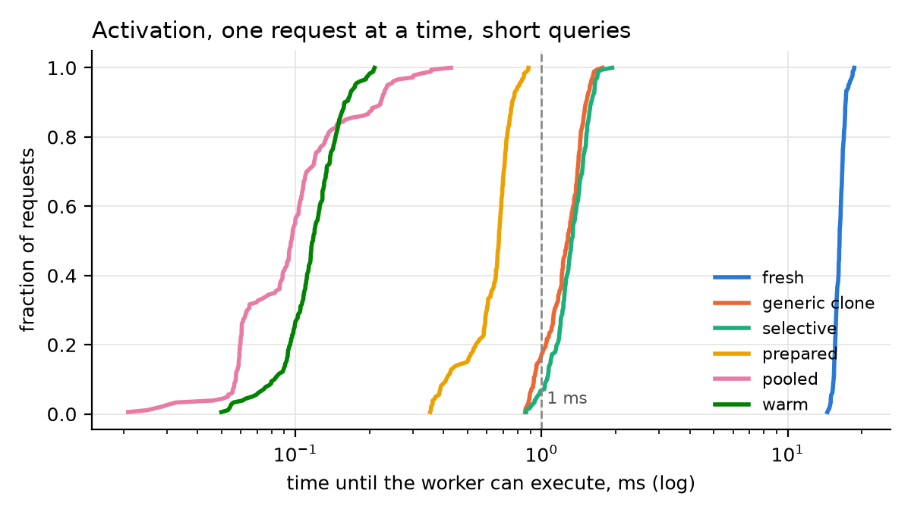
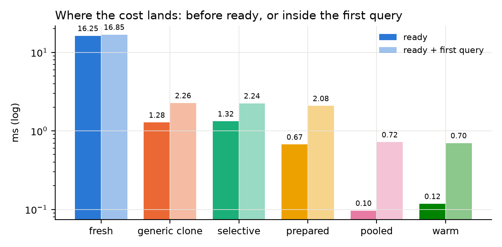
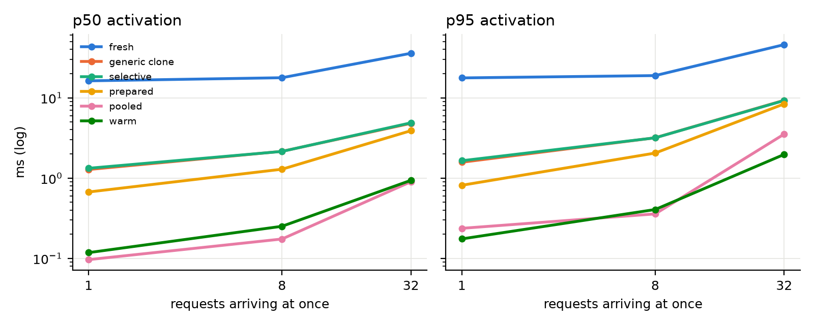
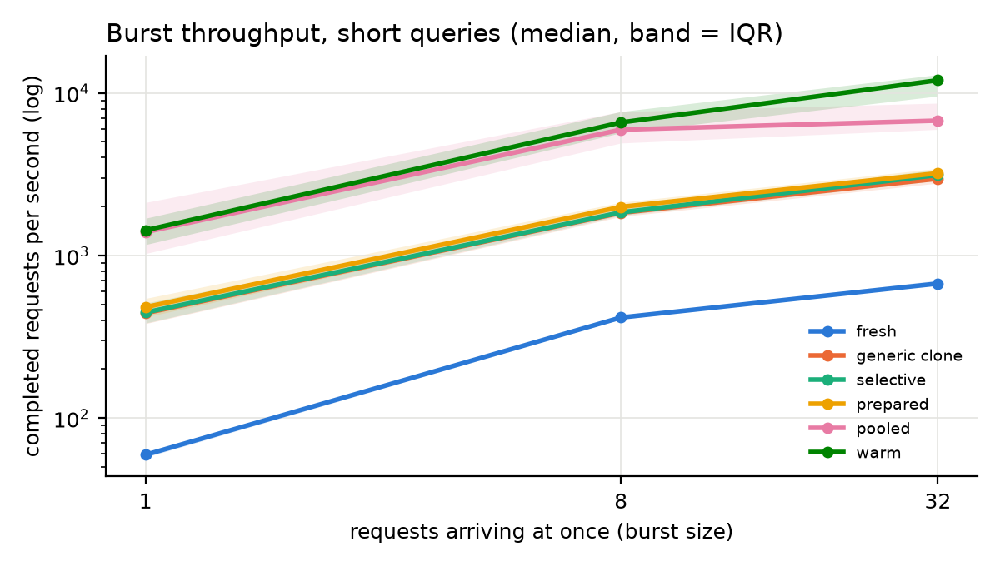
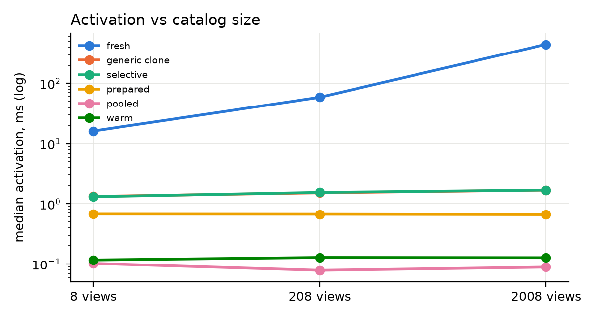
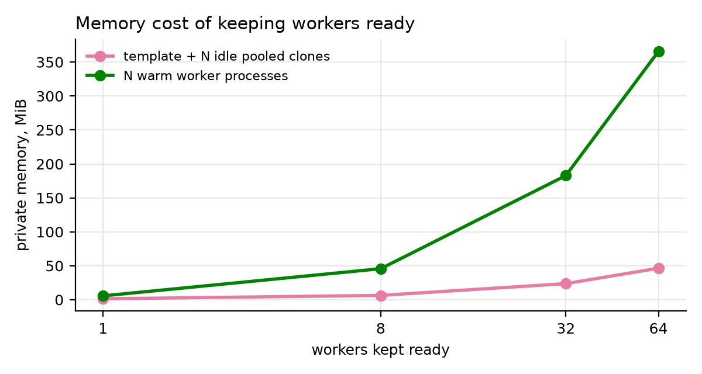
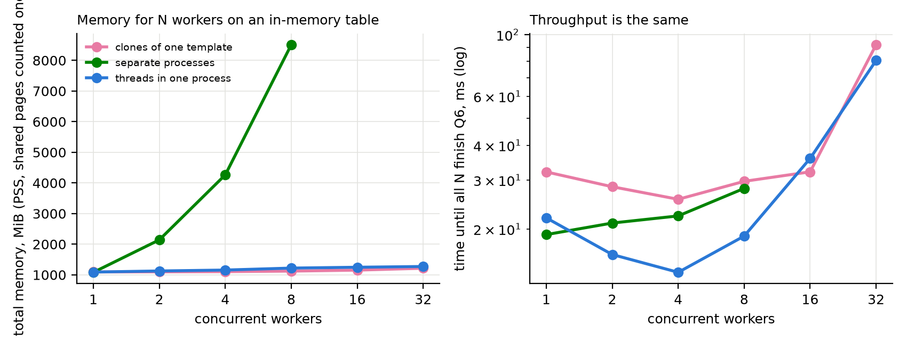
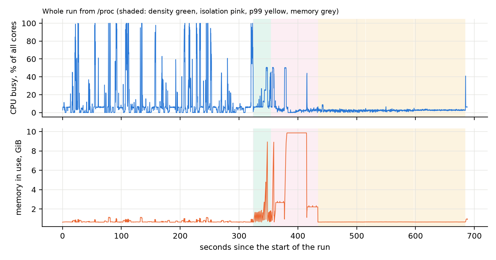
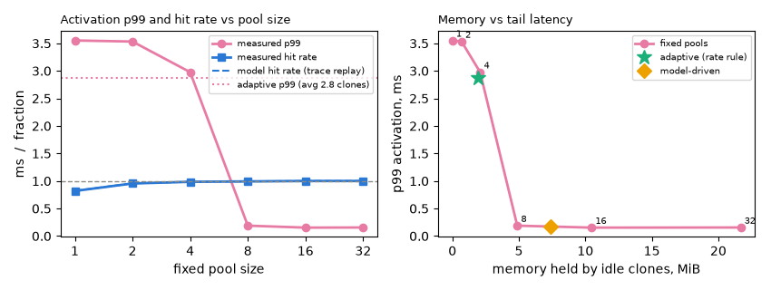

# serverless-olap-coldstart

This is the code for my database course project, "Towards Sub-Millisecond
Cold-Start for Serverless Vectorized OLAP". It is the final version for
milestone 2. The repo has the benchmark code, the one-command runner, the raw
traces and the plots, so every number below can be checked and reproduced.

## The idea

In a serverless database there might be no worker running when a query
arrives. A new worker has to load the engine, open it, read the catalog and
only then run the query. For small queries most of the time goes into this
start-up. On my laptop a fresh DuckDB worker needs about 16 ms before it can
run anything, and the short query itself takes well under 1 ms.

So I keep one process already initialized as a template, and when a request
comes I fork it instead of starting everything again. The new worker still
needs its own connection, but the library, the open database, the catalog and
the Parquet metadata come from the template through copy-on-write. DuckDB is
unmodified, I only use its C API.

Worker types. fresh starts a completely new process for every request, this
is the cold start baseline. generic clone forks the template and uses the
inherited state as it is. selective clone also forks, but rebuilds the
private parts (connection, temp folder) inside the child. prepared clone is a
bit different, the template prepares the private parts before forking.
pooled clone is forked before the request arrives, warms itself up and then
waits for work. warm keeps a full process running all the time, I use it as
the best case.

"ready" is arrival until the worker can execute, "done" is arrival until the
full result is fetched. I report both because they don't always move
together (anomaly b).

## What is in the repo

coldstart/ is the Python prototype I started from. template.py has the
template identity (a request can only use a template with the same engine
version, engine settings, dataset version and catalog) and the parts list,
which marks each engine part as reusable or private and rebuilds the private
ones in dependency order. workers.py has the worker modes, control.py sends
requests to workers and falls back to a fresh worker when no matching
template exists. settings.py pins the DuckDB version and engine settings,
queries.py has the SQL, measure.py reads timing and memory from /proc, and
gen_data.py generates the TPC-H Parquet files that the C code uses too.

native/ is the C version, which I use for all the numbers so Python doesn't
add its own time. coldbench.c is the main benchmark (six worker modes, five
queries, bursts of 1, 8 and 32, three catalog sizes, idle pool memory, long
single-request runs for the tail). density.c runs N workers at once as
clones, separate processes or threads, measures total PSS and does the
isolation tests. bench_native.py runs both over the experiment matrix,
plot_native.py makes the plots, csv files and summary.md, and duckdb_lib.py
fetches libduckdb on the first run.

pool.c is the pool controller that replays an arrival trace. The template
lives in its own single-threaded spawner process. The controller has a
dispatch loop and a refill thread, and the refill thread asks the spawner for
a new clone over a Unix socket. The spawner forks it and sends back the pid
and the clone's pipe with SCM_RIGHTS, so nothing is ever forked from a
multithreaded process. A request takes the oldest idle clone, and if the pool
is empty but a refill is under way it waits for that clone (a "late hit").
Controller and spawner spin instead of sleeping while they wait.
pool_replay.py builds the arrival traces (synthetic or Azure), runs pool for
each policy (fixed size, a rate rule, a model), compares with the controller
model and writes pool_replay.md, pool_replay.jsonl and the plot.

tools/sysmon.py samples /proc in the background during each step. In tests/,
test_workers.py checks that the Python worker types give the same results as
plain DuckDB, and test_harness.py builds the C benchmark, runs small bursts,
checks that every log line has the raw timestamps and that they agree with
the durations, and checks my percentile code against numpy (16 tests, all
pass in run.log). run_benchmarks.sh runs everything, the Makefile has the
single steps, and results/milestone2/ is the run this README reports.

## How to run it

Needs Linux (fork, /proc, WSL2 works), gcc, make and Python 3.10 or newer.

    pip install -r requirements.txt
    bash run_benchmarks.sh --name milestone2 --azure path/to/AzureFunctionsInvocationTraceForTwoWeeksJan2021.txt

That is the full run at TPC-H SF 0.1 and 1, about 45 minutes on my laptop.
--quick is a short sanity run at SF 0.1, --scales "0.1 1 3" picks other
scale factors, and --name sets the folder (default results/run-<time>).
Without --azure only the synthetic trace is replayed. libduckdb and the data
are fetched or generated on the first run, and a failed step goes into
failures.txt instead of stopping the script. The Azure trace is the Azure
Functions 2021 invocation trace (Zhang et al., "Faster and Cheaper Serverless
Computing on Harvested Resources", SOSP'21), public in the Azure Public
Dataset repository on GitHub.

The 10,000-activation runs for fresh, generic and warm (p99_extra.jsonl) were
one extra command, with M = fresh, clone_generic, warm.

    native/coldbench --data data/tpch_sf1 --mode M --query point --conc 1 --reps 10000

For single steps the Makefile has setup, data (SCALE=1), data-small, test,
bench, bench-quick, pool-replay, pool-replay-azure (AZURE=path PICK=busiest),
all (same as run_benchmarks.sh), clean and help.

A run folder has env.txt, run.log, commands.txt, failures.txt and index.md
(env plus every summary). Each native-sf<S>/ has events.jsonl, one raw line
per request with the CLOCK_MONOTONIC stamps t_arrive_ns, t_ready_ns and
t_done_ns, page faults, CPU time, context switches and private dirty memory
(events.csv is the same), latency_percentiles.csv (p50/p90/p95/p99),
throughput.csv (one row per burst), resources.csv, phases.jsonl,
manifest.json (arguments plus one reading of both clocks for wall time),
summary.md and plots/. Each pool-*/ has pool_replay.jsonl (one line per
request with t_sched_ns, t_dispatch_ns, t_ready_ns, t_done_ns), pool_replay.md,
trace_ms.txt, resources.csv and plots/. sysmon uses the same clock, so the
/proc samples and the events line up.

## Setup and settings

Machine is my laptop, AMD Ryzen 9 8945HX, 16 CPUs visible under WSL2, kernel
6.6.114.1-microsoft-standard-WSL2, DuckDB 1.5.6 (C library), Python 3.12.3.

perf does not work on the stock WSL2 kernel. run_benchmarks.sh checks and
writes "perf not usable on this kernel" into env.txt, so the system traces
come from /proc only. tools/sysmon.py samples the whole machine every 0.2 s (CPU
jiffies, context switches, run queue, memory, page faults) and each worker
reads /proc/self/stat, /proc/self/smaps_rollup and getrusage for itself.

DuckDB settings in coldbench.c and pool.c are threads=1 (so there are no
background threads at fork time), memory_limit 512MB and
enable_object_cache true. density.c uses memory_limit 2GB, and in the threads
case one engine with N threads.

Data is TPC-H SF 0.1 and SF 1 as Parquet, each table a view over
read_parquet. The queries are a point lookup on nation, a count on region, a
filter with ORDER BY LIMIT on supplier (these three are the "short
queries"), TPC-H Q6 and a cut-down Q1 on lineitem.

The experiment matrix in bench_native.py.

- all six worker modes, concurrency 1, 8 and 32 requests arriving at the
  same moment (Q1 only at 1)
- catalog size 0, 200 and 2000 extra views (point query, one at a time)
- 3 blocks, and the order of the conditions is shuffled in each block with a
  fixed seed. 20 reps per condition at concurrency 1, 5 bursts at 8 and 32
- idle memory of 1, 8, 32 and 64 pooled clones
- 10,000 activations one at a time for selective, prepared and pooled (only
  at the largest scale), plus the extra 10,000 for fresh, generic and warm
- density with N = 1, 2, 4, 8, 16, 32 workers running Q6 on lineitem loaded
  in memory, as clones, separate processes (only up to 8) and threads
- isolation, where worker 2 of 8 gets SIGKILL mid-query, and a second case
  with a per-worker RLIMIT_AS (its current use plus 1 GB) where worker 2
  allocates until the limit stops it

Pool replays (pool_replay.py, SF1, --rate 200) use fixed pool sizes 0 to 32,
the rate rule (called adaptive in the files, recent 100 ms peak rate x refill
time x 2, plus 1) and the model policy (every 250 ms it runs the last 5 s of
arrivals through the trace model, picks the smallest K that reaches the hit
target and holds the largest K of the last 20 s). The synthetic trace is 30 s
of Poisson arrivals at 120/s with 0.5 s bursts at 1200/s every 5 s (6,754
requests, mean 225/s). From the Azure trace I take the busiest hour of day 1
(10,014 invocations) and the quietest (429), both compressed 72x, so the busy
one replays at 200/s mean and 680/s peak and the quiet one stays quiet (9/s
mean, 200/s peak in 100 ms). Latency counts from the scheduled arrival, so
waiting in the controller is included.

## Results

Numbers are from native-sf1/summary.md and the pool_replay.md files in
results/milestone2 unless I say otherwise.

One request at a time, short queries, SF1, ms (n = 180 per mode).

    fresh            ready p50  16.25  p90  17.21  p99  18.43   done p50  16.85
    generic clone    ready p50   1.28  p90   1.52  p99   1.64   done p50   2.26
    selective        ready p50   1.32  p90   1.59  p99   1.71   done p50   2.24
    prepared         ready p50   0.67  p90   0.76  p99   0.87   done p50   2.08
    pooled           ready p50   0.10  p90   0.22  p99   0.36   done p50   0.72
    warm             ready p50   0.12  p90   0.16  p99   0.21   done p50   0.70

So a selective clone is ready about 12x faster than a fresh start (1.32 vs
16.25 ms) and a prepared one about 24x. End to end the gain is smaller
because the query still runs, 7.5x for generic and 8.1x for prepared. Pooled
is basically as fast as warm. SF 0.1 is almost the same (fresh 14.71,
prepared 0.67, pooled 0.09 ms ready p50), the short queries use small tables.

For the tail I ran 10,000 activations per mode, point query, one at a time.
The selective, prepared and pooled runs are in native-sf1/summary.md (with a
bootstrap upper bound on the p99), fresh, generic and warm are in
p99_extra.jsonl.

    fresh            p50 18.276  p99 22.411 ms
    generic clone    p50  1.341  p99  2.025 ms
    selective        p50  1.303  p99  1.769  upper 95% bound on p99 1.819 ms
    prepared         p50  0.652  p99  0.850  upper 95% bound on p99 0.858 ms
    pooled           p50  0.096  p99  0.334  upper 95% bound on p99 0.338 ms
    warm             p50  0.122  p99  0.198 ms

Pooled and prepared stay under 1 ms at the p99, generic and selective don't.
Fresh is a bit higher here than in the matrix run (p50 18.28 vs 16.25 ms),
it was a separate run.

Where the fresh start goes (fresh_phases lines in native-sf1/events.jsonl,
point query, one at a time, no extra views, 60 runs). Ready median 16.1 ms,
and per step process start and library 5.4 ms, engine open 7.1 ms, connect
about 0.01 ms, registering the 8 views 3.4 ms (medians per step, so they
don't add up exactly).

Prepared is ready fastest of the fork-on-demand modes, but done is close to
selective (anomaly b).

With 32 requests at once, ready p50 / p99 in ms are fresh 35.82 / 48.81,
generic 4.80 / 10.25, selective 4.88 / 10.66, prepared 3.89 / 9.25, pooled
0.90 / 4.64 and warm 0.94 / 2.67. All fork-on-demand clones come from one
template that forks them one after another, so the position in the burst
decides most of the wait. In events.jsonl the median ready time of a generic
clone goes 2.15, 3.82, 5.81, 8.32 ms for positions 0-7, 8-15, 16-23 and 24-31
(correlation 0.96). Pooled and warm don't fork during the burst and only jump
after position 16, where 32 requests start sharing 16 CPUs (pooled 0.42 to
2.19 ms, warm 0.46 to 1.56 ms).

Burst throughput is the number of requests in a burst divided by the time
until the last one finished (median over bursts, short queries, req/s).

    fresh            conc 1: 59     conc 8: 415    conc 32: 672
    generic clone    conc 1: 442    conc 8: 1,829  conc 32: 2,968
    selective        conc 1: 446    conc 8: 1,841  conc 32: 3,126
    prepared         conc 1: 481    conc 8: 1,989  conc 32: 3,208
    pooled           conc 1: 1,392  conc 8: 5,948  conc 32: 6,757
    warm             conc 1: 1,429  conc 8: 6,583  conc 32: 11,974

At 32 the fork-on-demand clones get 4 to 5x the fresh throughput and pooled
about 10x. Warm still wins at 32 (anomaly c).

Catalog size hurts fresh a lot and the clones almost not at all (anomaly e).

An idle pooled clone uses 0.71 MiB of private memory and an idle warm worker
process 5.7 MiB, so 8x more. Template plus 8 idle clones is 6.4 MiB, plus 64
it is 46.4 MiB. One refill (fork plus warm-up of a new clone) takes 2.23 ms
median, 2.75 ms p95. The template itself has an RSS of about 36 MB.

N workers running Q6 on lineitem loaded in memory (total PSS, MiB).

    clones of one template   N=1: 1095  N=8: 1122  N=32: 1216
    separate processes       N=1: 1083  N=8: 8510
    threads in one process   N=1: 1091  N=8: 1221  N=32: 1273

When worker 2 of 8 is killed, or hits its memory limit, 7 of 8 queries still
finish for clones and for separate processes, and 0 of 8 for threads because
the whole process dies. So clones get about the memory of threads and the
isolation of processes. At N=32 clones are even a bit smaller than threads
here (1216 vs 1273 MiB).

/proc over the whole SF1 run (3430 samples). CPU busy mean 8% and peak 100%
(the 32-request bursts), 4,024 context switches per second on average, memory
peak 9.9 GiB during the density and isolation part (separate processes each
hold lineitem), 48 major page faults. The result check in summary.md shows
all six modes return the same first value for every query.

Busiest Azure hour, from pool-azure-busiest/pool_replay.md (late means the
pool was empty and the request took the clone being made).

    fixed 0    hit   0.0%  late  0.0%   p50 0.48  p99 3.29 ms
    fixed 1    hit  81.9%  late 12.2%   p50 0.05  p99 3.55 ms
    fixed 2    hit  95.5%  late  4.2%   p50 0.04  p99 3.53 ms
    fixed 4    hit  98.5%  late  1.5%   p50 0.04  p99 2.98 ms
    fixed 8    hit  99.3%  late  0.7%   p50 0.05  p99 0.19 ms
    fixed 16   hit 100.0%  late  0.0%   p50 0.05  p99 0.15 ms
    adaptive   hit  98.4%  late  1.6%   p50 0.05  p99 2.87 ms   2.8 clones avg
    model      hit  99.6%  late  0.3%   p50 0.05  p99 0.16 ms  10.5 clones avg

With no pool every request forks a prepared clone and the p99 is 3.29 ms.
With 8 idle clones the whole path, controller included, has p99 0.19 ms (0.15
ms with 16). The model policy gets the same tail (0.16 ms) with 10.5
clones on average, so about 7 MiB at the measured 0.71 MiB per clone. The rate
rule keeps too few clones (2.8 on average) and its p99 stays at 2.87 ms.

The controller model predicts the hit rate of each fixed pool size well. It
is within about 0.3 points on the busiest hour (82.2 vs 81.9% at K=1 is the
worst), about 0.5 on the quietest (57.8 vs 58.3% at K=1) and about 2 on the
synthetic trace (89.4 vs 87.2% at K=2).

The quietest hour is harder.

    fixed 8    hit  88.6%  late 11.4%   p99 5.65 ms
    fixed 16   hit 100.0%  late  0.0%   p99 1.76 ms
    fixed 32   hit 100.0%  late  0.0%   p99 1.39 ms
    adaptive   hit  66.0%  late 31.5%   p99 8.29 ms    1.0 clones avg
    model      hit  95.1%  late  3.5%   p99 4.29 ms   14.2 clones avg

Its bursts are short and sharp (200/s peak against 9/s mean), so 8 clones
are not enough, and the rate rule, which sizes the pool for one refill time,
keeps about one clone and gives 31.5% late hits. The model policy has only 6 true misses, and
all 6 are in the very first burst at the start of the replay, when it has no
history yet. With only 429 requests the p99 is about the 5th slowest request,
so that first burst alone sets the model's p99. Even with 16 or 32 clones and
a 100% hit rate the p99 stays above 1 ms (anomaly d). On the synthetic trace 8
clones already give 100% hits and p99 0.14 ms, and the rate rule and model
are close (p99 1.51 and 1.71 ms).

## Anomalies

a) One or two clones are worse at the p99 than no pool

On the busiest hour the p99 is 3.55 ms with one clone and 3.53 ms with two,
both worse than 3.29 ms with no pool at all. At K=1, 12.2% of the requests
were late hits (1,218 of 10,014 in pool_replay.jsonl). A late hit waits for
the clone the refill thread is still making, and a refill is a fork plus
warm-up queries (2.23 ms median), while a miss only forks a prepared clone
(no pool p50 0.48 ms). The after-dispatch p99 shows the same thing, 0.77 ms
with no pool and 2.07 ms at K=1. The same happens on the synthetic trace
(2.48 with no pool, 3.02 and 3.03 ms with one and two clones). So with a tiny
pool, waiting for the refill is the wrong choice. The controller could
compare how far the refill is with the cost of a miss, I haven't done that.

b) Prepared clone moves its page faults into the first query

Prepared is ready in 0.67 ms against 1.32 for selective, but done is 2.08
against 2.24 ms, only 0.16 ms better. Minor page faults before ready plus
during the query (native-sf1/summary.md) are prepared 5+412, selective
233+195 and pooled 1+51. The query part (done minus ready, median, short
queries, one at a time, from events.jsonl) is 1.52 ms for prepared, 0.91 for
selective, 0.58 for pooled and 0.57 for warm. The template makes the
connection before the fork, so the child is ready almost at once, but its
first query writes to engine pages still shared with the template and takes
the copy-on-write faults there. The faults just moved behind the ready
timestamp, which is why I report ready and done separately. The pooled clone
takes them during its warm-up, before the request arrives.

c) Warm processes beat pooled clones at 32 concurrent requests

At concurrency 1 and 8 pooled and warm are close (1,392 vs 1,429 and 5,948
vs 6,583 req/s), but with 32 requests on 16 CPUs warm does 11,974 req/s and
pooled 6,757. Warm pays for this with 8x the idle memory (5.7 vs 0.71 MiB
per worker). One likely reason is that each pooled clone still takes about
50 minor faults in its query (1+51 in summary.md, warm has 0+0), and with 32
clones on 16 CPUs those faults all hit the kernel at the same time (done p50
at 32 is 2.02 vs 1.61 ms). I didn't measure the fault cost directly, so this
is my best guess, not a proven one.

d) Quiet hour p99 stays above 1 ms even with 16 or 32 clones

With 16 and 32 clones every request on the quietest hour found a waiting
clone, but the p99 is 1.76 and 1.39 ms, while on the busiest hour it is 0.15
and 0.16 ms. I looked at the slowest requests in pool_replay.jsonl. With 16
clones the slowest one took 2.05 ms, of which only 0.19 ms was before
dispatch, and the others in the top 6 look the same. The after-dispatch p99
is 1.53 ms (16 clones) and 1.26 ms (32), against 0.14 ms on the busy hour. So
the time is lost after the controller hands the request to an idle clone. My
guess is that on a quiet machine the clone sits on a virtual CPU that has
gone idle and must wake up first, but I can't see that from inside WSL2.

e) Clone activation barely changes with catalog size

Median ready time, point query, one at a time, for 0 / 200 / 2000 extra
views (from native-sf1/events.jsonl like the plot, not in summary.md) is
fresh 16.1 / 58.5 / 443.0 ms, generic 1.33 / 1.52 / 1.69, selective
1.31 / 1.55 / 1.69, prepared 0.67 / 0.67 / 0.66 and pooled about 0.1 in all
three. Fresh grows about 27x because every new process has to register all
the views again. The template pays that once when it is built (443.5 ms median
with 2000 views) and after that every clone gets the catalog for free. The
small growth for generic and selective is probably the bigger catalog pages
they touch when they make their own connection.

f) Warm Q1 and Q6 timings are not valid

In warm mode coldbench.c sends the next request after a fixed sleep (20 ms,
or 200 ms for bursts) instead of waiting for the reply. The short queries
finish long before that, but Q1 takes about 86 ms, so requests queue up and
the queueing counts as ready time. In native-sf1/events.jsonl warm Q1 ready
goes 0.3, 66.6, 132.2 ms and so on up to 1245.5 ms for rep 19 in block 0, and
latency_percentiles.csv shows warm Q1 ready p50 636 ms and warm Q6 at 32
47.8 ms. So I leave the warm long-query numbers out, including the warm Q1
and Q6 bars in done_per_query.png at SF1. All tables above use only the short
queries, where the warm numbers are fine.

## Known problems and limitations

Everything was measured on one machine under WSL2. Fork is probably slower
there than on plain Linux, so the clone numbers may be a bit pessimistic,
and perf doesn't work, so I only have /proc traces. The templates are small
(about 36 MB RSS), with a bigger catalog or more cached metadata a clone may
copy more pages. Clones run DuckDB with threads=1 because there must be no
background threads at fork time, so a long query can't use more than one
core.

Controller and spawner spin while waiting, so each costs a full core during
a replay. In resources.csv about 2 cores are busy for the whole quietest-hour
replay even though it has only 9 requests per second.

The memory column in pool_replay.md is an estimate, not a measurement. It is
average idle clones times 0.70 MiB, a constant in pool_replay.py, and the
measured idle clone is 0.71 MiB at SF1. The average is sampled right after a
dispatch, so it reads about one clone low (fixed 8 shows 7.0).

The workload is read-only, writes would need a way to keep the template's
catalog in sync. A real platform also has container start-up, which I don't
model.

## Note on AI use

AI was used in this project to search for references and to paraphrase or
improve the writing. I ran every experiment myself on my laptop.
